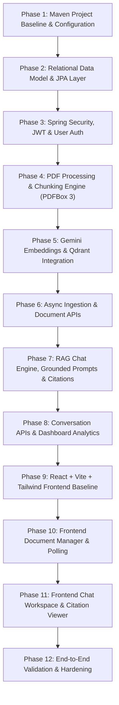

# Phased Implementation Roadmap: AI Document Assistant (RAG)

This roadmap outlines the sequential, testable development operations for building the AI Document Assistant. Each phase is self-contained with clear completion criteria and verification steps. 

> **Important Protocol:** After each operation, a report must be generated and presented for review with ChatGPT before advancing to the subsequent phase.

---

## Roadmap Overview

---

## Phase 1: Maven Project Baseline & Configuration
- **Task Goal:** Establish the Spring Boot project skeleton, dependencies, configuration profiles, and Maven build setup.
- **Deliverables:**
  - `pom.xml` with Spring Boot 3.4.3, Spring AI BOM 1.1.0, MySQL Connector/J 9.1.x, Spring Security 6, JJWT 0.12.6, Apache PDFBox 3.0.4, and JUnit 5/Mockito test dependencies.
  - `application.yml` referencing environment variables (`.env`).
  - Main application class: `AiDocumentAssistantApplication.java`.
- **Completion Criteria:**
  - Maven build compiles cleanly (`mvn clean compile`).
  - Application boots up in dev profile without errors.
- **Verification Steps:**
  - Execute `mvn clean compile`.
  - Verify Spring Boot banner and successful context loading test (`@SpringBootTest`).
- **Checkpoint:** Share Phase 1 execution report with ChatGPT for review.

---

## Phase 2: Relational Data Model & JPA Layer
- **Task Goal:** Implement MySQL database entities, relationships, constraints, and Spring Data JPA repositories.
- **Deliverables:**
  - Entities: `User`, `Document`, `DocumentStatus` (`PENDING`, `PROCESSING`, `READY`, `FAILED`, `DELETING`, `DELETION_FAILED`), `Conversation`, `Message`, `MessageRole`, `MessageSource`.
  - Repositories: `UserRepository`, `DocumentRepository`, `ConversationRepository`, `MessageRepository`, `MessageSourceRepository`.
  - Database schema initialization / validation script or migration setup.
- **Completion Criteria:**
  - All foreign keys (`ON DELETE CASCADE`), unique constraints, and indexes defined in architecture are implemented.
  - Clarified in repository layer: MySQL foreign-key cascading only cleans up MySQL child tables (`conversation_documents`, `message_sources`), NOT Qdrant vector points.
  - Repositories provide user-filtered retrieval methods with status checks (e.g., `findAllByIdInAndUserIdAndStatus`).
- **Verification Steps:**
  - Execute Repository slice tests (`@DataJpaTest`) with an embedded or test database.
  - Verify entity cascading and constraint enforcement through unit tests.
- **Checkpoint:** Share Phase 2 execution report with ChatGPT for review.

---

## Phase 3: Spring Security, JWT & User Authentication
- **Task Goal:** Implement secure registration, authentication, JWT generation, and stateless filter protection.
- **Deliverables:**
  - `JwtTokenProvider`, `JwtAuthenticationFilter`, `SecurityConfig`.
  - `AuthService`, `AuthController` (`/api/auth/register`, `/api/auth/login`, `/api/auth/me`).
  - DTOs: `RegisterRequest`, `LoginRequest`, `AuthResponse`.
  - Global exception handling for authentication and validation errors.
- **Completion Criteria:**
  - Passwords hashed with BCrypt (strength 12).
  - Protected endpoints reject unauthenticated requests with HTTP 401.
  - Authenticated requests correctly inject user principal into `SecurityContextHolder`.
- **Verification Steps:**
  - Unit tests for `JwtTokenProvider` (signing, expiration, tampering rejection).
  - Controller integration tests (`@WebMvcTest` or `MockMvc`) for registration, login, and token-based access.
- **Checkpoint:** Share Phase 3 execution report with ChatGPT for review.

---

## Phase 4: Local File Storage & PDF Processing Engine
- **Task Goal:** Build secure document storage and text extraction with Apache PDFBox 3.0.4.
- **Deliverables:**
  - `FileStorageService`: Safe file naming (UUID), size validation, saving outside web root (`./storage/uploads/`).
  - `PdfProcessingService`: Page-by-page text extraction with page numbers preserved using `Loader.loadPDF()`.
  - `DocumentChunker`: Configurable token-aware chunking with overlap (e.g., 500 tokens, 50-token overlap).
  - Test fixture PDFs stored in `src/test/resources/fixtures/` (safely whitelisted in `.gitignore`).
- **Completion Criteria:**
  - Validates PDF MIME types and magic bytes (`%PDF-`).
  - Successfully extracts text from sample multi-page PDFs with accurate page indices.
  - Produces structured chunk objects with document ID, page number, and chunk index.
- **Verification Steps:**
  - Unit tests with mock and fixture PDF files verifying page preservation and chunk overlap.
  - Security unit test verifying path traversal rejection (e.g., `../../malicious.pdf`).
- **Checkpoint:** Share Phase 4 execution report with ChatGPT for review.

---

## Phase 5: Google Gemini Embeddings & Qdrant Integration
- **Task Goal:** Integrate Google Gemini embedding model (`gemini-embedding-001`) and Qdrant vector database with multi-tenant filtering.
- **Deliverables:**
  - `QdrantConfig` and `GeminiAiConfig`.
  - `EmbeddingService`: Batch text embedding using Gemini `gemini-embedding-001` with explicit 768 output dimensions (MRL).
  - `VectorStoreService`: Qdrant collection initialization (768 dimensions, Cosine metric), payload keyword index creation (`user_id`, `document_id`), vector upsert with metadata, filtered search (`user_id` + `document_id`), and vector point deletion by filter.
- **Completion Criteria:**
  - Vectors successfully embedded and upserted with metadata payload.
  - Document chunk embeddings and query embeddings strictly use identical model and 768 dimensions.
  - Vector similarity search strictly applies `user_id` and permitted `document_id` filters.
  - Document deletion properly purges associated vectors from Qdrant via point deletion filter.
- **Verification Steps:**
  - Mocked integration tests for `VectorStoreService` verifying payload construction and filter composition.
  - Verification of collection setup against local or test Qdrant instance.
- **Checkpoint:** Share Phase 5 execution report with ChatGPT for review.

---

## Phase 6: Asynchronous Ingestion Pipeline & Document REST APIs
- **Task Goal:** Wire together file upload, asynchronous background processing, document status tracking, and document CRUD endpoints with safe deletion orchestration.
- **Deliverables:**
  - `DocumentService`: `@Async` ingestion workflow managing transitions (`PENDING` $\rightarrow$ `PROCESSING` $\rightarrow$ `READY` or `FAILED`).
  - Document deletion workflow:
    - Step 1: User ownership verified in Java.
    - Step 2: Status updated to `DELETING` in MySQL (immediately rendering it invisible to RAG retrieval).
    - Step 3: Purge points from Qdrant matching `user_id` and `document_id`.
    - Step 4: Delete local file from disk.
    - Step 5: Delete MySQL row (cascading only to relational child tables in MySQL).
    - Step 6: On Qdrant/disk failure, transition status to `DELETION_FAILED` for retry.
  - `DocumentController`:
    - `POST /api/documents/upload`
    - `GET /api/documents`
    - `GET /api/documents/{id}`
    - `GET /api/documents/{id}/status`
    - `DELETE /api/documents/{id}`
- **Completion Criteria:**
  - Upload returns HTTP 202 Accepted immediately while ingestion processes in background.
  - Document status updates to `READY` on success or `FAILED` with an error message on failure.
  - Deletion removes Qdrant vectors, local file, and database record, with immediate exclusion from retrieval.
- **Verification Steps:**
  - Integration tests with `MockMvc` testing upload, status polling, and cross-user authorization rejection (HTTP 403/404).
  - Test verifying that a document in `DELETING` or `DELETION_FAILED` status is excluded from search queries.
- **Checkpoint:** Share Phase 6 execution report with ChatGPT for review.

---

## Phase 7 & 8: RAG Retrieval Engine, Grounded Chat & Conversation Management (Completed in Task 9)
- **Status:** **COMPLETED**
- **Deliverables:**
  - `RagChatService`: Complete end-to-end RAG pipeline executing user message persistence, scoped document resolution, query embedding via Gemini, multi-tenant Qdrant vector retrieval, relational defense-in-depth readiness check, grounded Gemini synthesis with prompt injection defenses, server-side citation validation, and atomic response/citation persistence.
  - `ConversationController`: REST API endpoints under `/api/conversations` (`POST`, `GET`, `GET /{id}`, `DELETE /{id}`, `POST /{id}/messages`, `GET /{id}/messages`, `POST /{id}/documents`, `DELETE /{id}/documents/{documentId}`, `GET /{id}/documents`).
  - DTOs: `CreateConversationRequest`, `AddDocumentsRequest`, `SendMessageRequest`, `CitationResponse`, `MessageResponse`, `ConversationResponse`, `ConversationDetailResponse`, `ChatAnswerResponse`.
  - Transaction Boundaries: Segregated database transactions from external AI calls; user messages persist before external calls; assistant responses and citations commit together.
  - Concurrency Guard: Per-conversation in-memory synchronization locks prevent interleaved messages and preserve strict chronological ordering.
  - Automated Tests: 24 comprehensive scenarios implemented in `RagChatPipelineTest.java` (total project test suite: 99 tests, 100% passing).
- **Verification:**
  - `mvn clean test` (99 tests passing, 0 failures, 0 errors).
  - `mvn package -DskipTests` (BUILD SUCCESS).

---

## Phase 9, 10 & 11: React + Vite + Tailwind Frontend Foundation, Document Manager & Grounded Chat (Task 10)
- **Status:** COMPLETED
- **Implemented Scope:**
  - Stack: React 18, Vite 6, TypeScript 5.7, Tailwind CSS 3.4, React Router 6, Axios, Lucide React, Vitest.
  - Structure: Separated in `frontend/` directory with production build pipeline and zero-warning ESLint 9 configuration.
  - Authentication: `LoginPage`, `RegisterPage`, `ProtectedRoute`, `AuthContext` with configurable `TokenManager` (tab-scoped `sessionStorage` or in-memory).
  - API Client: Centralized Axios instance with automatic JWT Bearer injection and 401 session expiration handling.
  - Document Manager: `DocumentsPage`, `DocumentUploadModal` (drag-and-drop, client-side PDF validation, upload progress), `StatusBadge` (all 6 statuses), background polling for active states, process triggers, and delete confirmation dialogs.
  - Conversation Workspace: `ConversationsPage`, two-pane layout with mobile drawer, `DocumentScopeSelector` (All READY docs vs scoped docs), `MessageList`, `MessageItem`, `MessageComposer` (4,000 char limit, duplicate prevention, draft preservation), and `CitationCard` (page numbers, relevance score badges, expand/collapse snippets).
  - Automated Tests: 20 comprehensive unit and integration tests across 5 test suites covering all required scenarios (form validations, protected routes, logout, token injection, 401 interceptor, upload validation, status badges, composer rules, citation rendering, and mobile navigation).
- **Verification:**
  - `npm run lint` (0 errors, 0 warnings).
  - `npm test` (20 tests run, 20 passed, 0 failures).
  - `npm run build` (Clean production bundle generated in `frontend/dist/`).

---

## Phase 12: End-to-End Validation, Hardening & Final Documentation
- **Task Goal:** Perform cross-cutting security checks, end-to-end integration tests, and produce complete deployment/user documentation.
- **Deliverables:**
  - End-to-end test suite verifying multi-tenant isolation and RAG pipeline.
  - Comprehensive `README.md` covering prerequisites, MySQL setup, Qdrant setup via Docker, environment variables, backend run instructions, and frontend run instructions.
  - Code review and hardening checklist.
- **Completion Criteria:**
  - All automated backend and frontend tests pass.
  - Full end-to-end workflow (register $\rightarrow$ upload PDF $\rightarrow$ create conversation $\rightarrow$ ask question $\rightarrow$ view citation $\rightarrow$ delete document) verified.
  - Multi-tenant boundary verified with two separate test accounts.
- **Verification Steps:**
  - Run full Maven test suite (`mvn clean test`).
  - Run frontend production build (`npm run build`).
  - Manual audit against the 15 system requirements.
- **Checkpoint:** Final project completion review.
